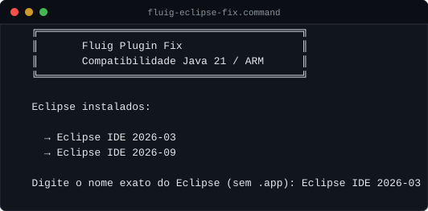
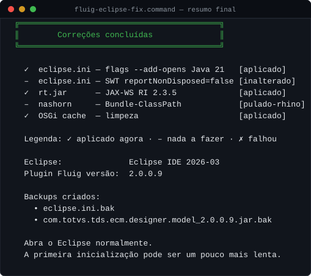

# fluig-eclipse-fix-macos

[](https://github.com/pablooav/fluig-eclipse-fix-macos/tags)
[](https://github.com/pablooav/fluig-eclipse-fix-macos/actions/workflows/ci.yml)
[](#escopo-e-requisitos)
[](#escopo-e-requisitos)
[](#matriz-de-homologação)
[](#testes)
[](LICENSE)

Faz o **plugin TOTVS Fluig Studio** funcionar no Eclipse em **macOS Apple Silicon** com Java 17 ou superior.

O plugin foi construído para um mundo pré-JPMS (Java 8/11). Em JDKs modernos ele instala, resolve e *aparenta* funcionar — até você tentar exportar um processo, subir um formulário ou abrir a árvore de servidores. As falhas são silenciosas ou trazem mensagens que não apontam a causa.

Este repositório traz um script que aplica as correções necessárias e, mais importante, **documenta o porquê de cada uma** — para você auditar o que será feito na sua instalação antes de rodar.

```bash
./fluig-eclipse-fix.command
```

---

## Aviso

- **Projeto não oficial.** Sem vínculo com a TOTVS ou com a Eclipse Foundation. A TOTVS homologa o Fluig Studio apenas para **Windows e Linux** — macOS não é plataforma suportada por eles, e é exatamente por isso que este repositório existe.
- **O script modifica a sua instalação do Eclipse:** reescreve o `eclipse.ini`, reempacota jars dentro de `plugins/` e apaga o cache OSGi. Tudo que é alterado ganha backup, e a reversão está documentada [no fim](#backups-e-reversão).
- **Feche o Eclipse antes de rodar.**
- Nenhuma correção depende de credencial, servidor ou dado do seu ambiente. O script só lê e escreve dentro do bundle `.app` que você escolher.

---

## Índice

- [Preciso disto?](#preciso-disto)
- [Instalação do zero](#instalação-do-zero)
- [Escopo e requisitos](#escopo-e-requisitos)
- [De onde vem o JDK](#de-onde-vem-o-jdk)
- [A partir de qual Java cada correção é necessária](#a-partir-de-qual-java-cada-correção-é-necessária)
- [O problema](#o-problema)
- [As correções](#as-correções)
- [Aplicação condicional](#aplicação-condicional)
- [Dependência de versão](#dependência-de-versão)
- [Matriz de homologação](#matriz-de-homologação)
- [Problemas conhecidos](#problemas-conhecidos)
- [Histórico de correções no próprio script](#histórico-de-correções-no-próprio-script)
- [Modo automatizado](#modo-automatizado)
- [Testes](#testes)
- [Integração contínua](#integração-contínua)
- [Backups e reversão](#backups-e-reversão)
- [Contribuindo](#contribuindo)
- [Licença](#licença)

---

## Preciso disto?

Se você está num Mac com Eclipse recente e o Fluig Studio instalado, provavelmente sim. Os sintomas:

| Sintoma | Causa | Correção |
|---|---|---|
| Exportar processo/workflow falha com `NoClassDefFoundError: Could not initialize class com.sun.xml.ws.model.Injector` | reflexão bloqueada pelo JPMS | [Fix 1](#fix-1----add-opens-no-eclipseini) |
| Exportar falha com erro de JAX-WS que não é o acima | biblioteca JAX-WS de 2018 | [Fix 3](#fix-3--rtjar-jax-ws-ri-231--235) |
| `java.lang.Error: SWT Resource was not properly disposed` ao abrir a árvore de servidores | vazamento de `Image` no plugin | [Fix 2](#fix-2--reportnondisposedfalse) |
| Erro de script / `ScriptEngine` nulo em plugins antigos (1.7.x) | Nashorn removido do JDK | [Fix 4](#fix-4--nashorn-standalone-no-bundle-classpath) |
| Aplicou um patch e nada mudou | cache OSGi | [Fix 5](#fix-5--limpeza-do-cache-osgi) |

O script detecta o que é necessário e **pula o que não é** — rodar numa instalação já correta não faz mal e não baixa nada.

Dois erros comuns que aparecem no mesmo caminho mas **não** são deste escopo:

- `SSLHandshakeException: No subject alternative names matching IP address ...` — o servidor Fluig foi cadastrado por IP e o certificado só tem nome DNS. Cadastre pelo hostname.
- `UnknownHostException` no hostname do servidor — DNS do seu ambiente, não do plugin.

---

## Instalação do zero

### 1. Eclipse

Baixe em [eclipse.org/downloads/packages](https://www.eclipse.org/downloads/packages/) o pacote **Eclipse IDE for Enterprise Java and Web Developers**, arquitetura **macOS AArch64** (Apple Silicon).

Qualquer release que rode em Java 17+ serve. Na prática, todas de 2024-09 em diante exigem Java 21 — veja [Escopo e requisitos](#escopo-e-requisitos) para conferir a sua.

> Se você mantém mais de um Eclipse lado a lado, o script procura em `/Applications` e em `/Applications/Eclipses`. Criar essa pasta `Eclipses` é uma convenção prática, não um requisito — você também pode passar o caminho direto com `--eclipse`.

### 2. Plugin Fluig Studio

Com o Eclipse aberto: **Help → Install New Software… → Add…**

Faça a instalação normalmente conforme a documentação da totvs ([IDE Installation, no TDN](https://tdn.totvs.com/pages/releaseview.action?pageId=73078179))

Reinicie o Eclipse. A perspectiva fica em **Window → Open Perspective → Other… → Fluig**.

Neste ponto o plugin está instalado e **ainda não funciona direito no macOS**. É aqui que entra o script.

### 3. Rodar o script

**Feche o Eclipse.**

```bash
git clone https://github.com/pablooav/fluig-eclipse-fix-macos.git
cd fluig-eclipse-fix-macos
./fluig-eclipse-fix.command
```

Se preferir baixar o ZIP pelo botão **Code** do GitHub, o macOS marca o arquivo como em quarentena e bloqueia a execução. Libere com:

```bash
chmod +x fluig-eclipse-fix.command && xattr -d com.apple.quarantine fluig-eclipse-fix.command
```

O script lista os Eclipse encontrados e espera o nome. **É o único ponto em que você interage:**



Digite o nome **exatamente como aparece na lista**, sem o `.app`. Daí ele segue sozinho, aplicando só o que for necessário.

No fim, o resumo diz item por item o que foi aplicado agora (`✓`), o que já estava certo (`–`) e o que falhou (`✗`):



Neste exemplo o Fix 2 não tinha o que fazer e o Fix 4 foi pulado porque o plugin 2.0.0.9 já embarca motor JS próprio — comportamento correto, não erro. O código de saída é `0` quando nada falhou.

> As duas imagens são saída real do script, geradas por `docs/gerar-prints.sh` contra instalações de teste. Se a saída mudar, rode o gerador de novo em vez de editar os SVGs à mão.

### 4. Validar

Abra o Eclipse — a primeira inicialização é mais lenta, porque o cache OSGi está sendo reconstruído — e refaça a operação que te trouxe aqui: exportar um processo, subir um formulário, abrir a árvore de servidores.

Funcionou? **[Contribua com uma linha na matriz de homologação](#contribuindo)** informando sua versão de Eclipse e de plugin. É o que faz este repositório valer para a próxima pessoa.

---

## Escopo e requisitos

**Alvo:** Eclipse nativo Apple Silicon (aarch64) rodando em Java 17 ou superior.

Para conferir a sua instalação:

```bash
grep -E "requiredJavaVersion" "/Applications/SEU-ECLIPSE.app/Contents/Eclipse/eclipse.ini"
```

Se aparecer `-Dosgi.requiredJavaVersion=17` ou maior, você está no escopo.

**Fora de escopo:**

- Eclipse x86_64 sob Rosetta
- Releases antigas presas ao Java 8 (Neon, Oxygen e similares) — nelas o plugin funciona sem patch
- Windows e Linux — plataformas que a TOTVS homologa; as correções não são necessárias lá

**Ferramentas:** `curl`, `zip`, `unzip`, `python3`. Todas vêm com o macOS, exceto o `python3`, que chega com as Command Line Tools:

```bash
xcode-select --install
```

**Rede:** usada apenas quando algum download é de fato necessário (Fix 3 e Fix 4). Em instalações recentes do plugin, normalmente nenhum.

---

## De onde vem o JDK

**O JDK vem junto com o Eclipse.** Os pacotes EPP embarcam uma JRE **JustJ** dentro de `plugins/`, e o `eclipse.ini` aponta para ela via `-vm`. Não há instalação separada, e o JDK é atualizado pelo p2 junto com a release.

Confira no seu:

```bash
grep -A1 "^-vm$" "/Applications/SEU-ECLIPSE.app/Contents/Eclipse/eclipse.ini"
```

Saída típica:

```
-vm
../Eclipse/plugins/org.eclipse.justj.openjdk.hotspot.jre.full.macosx.aarch64_21.0.12.v20260826-1216/jre/lib/libjli.dylib
```

Um JDK instalado em `/Library/Java/JavaVirtualMachines/` existe na máquina mas **não é usado** pelo Eclipse, a menos que você troque o `-vm` à mão.

### O que isso significa para testes

A release do Eclipse **determina** o major do JDK. Releases diferentes que embarcam a mesma JustJ 21 se comportam igual no que diz respeito ao Fix 1 — não é preciso validar cada uma separadamente. Esse eixo só volta a se mover quando uma release futura subir de major (Java 25, 26…), ou se você sobrescrever o `-vm`.

---

## A partir de qual Java cada correção é necessária

A pergunta natural é "a partir de qual Java isso deixa de ser incompatível?". A resposta é desconfortável: **não deixa**. Cada correção tem um Java em que passou a ser necessária, e nenhuma tem um Java em que deixa de ser. A direção da plataforma é sempre a de fechar mais.

| Java | O que mudou na plataforma | Efeito no plugin Fluig |
|---|---|---|
| 8 | — | funciona sem patch: o JDK traz JAX-WS e o Nashorn |
| 9–10 | JPMS chega, mas com `--illegal-access=permit` por padrão | avisos de reflexão; ainda funciona |
| **11** | JEP 320 remove `java.xml.ws` e `java.xml.bind` do JDK | o `rt.jar` embarcado vira a única fonte de JAX-WS → **Fix 3 passa a importar** |
| **15** | JEP 372 remove o Nashorn | `getEngineByName("js")` devolve `null` → **Fix 4 necessário** (quando o plugin não traz Rhino) |
| **16** | JEP 396: *strong encapsulation* vira o padrão | `setAccessible` sobre `ClassLoader.defineClass` lança `InaccessibleObjectException` → **Fix 1 necessário** |
| **17** | JEP 403 remove a opção `--illegal-access` | acabou a escapatória: `--add-opens` passa a ser a única saída |
| 21 | JustJ das releases atuais | todas as condições acima valem simultaneamente |
| 24 | JEP 498: acesso a memória via `sun.misc.Unsafe` passa a avisar | risco novo, ainda não medido aqui |
| 26 | JEP 500: mutação de campo `final` por reflexão passa a avisar | **`--add-opens` deixa de bastar sozinho** para esse caso |

### Sobre o Java 26

No JDK 26, abrir o pacote continua necessário mas já **não é suficiente** para mutar um campo `final` por reflexão: é preciso também `--enable-final-field-mutation`. O padrão hoje é `warn`; o padrão futuro anunciado é `deny`, e aí `Field::set` lança `IllegalAccessException`.

Isso **não** afeta o caso que o Fix 1 resolve hoje — o `com.sun.xml.ws.model.Injector` *invoca* métodos de `ClassLoader`, não muta campos finais. Mas é o primeiro sinal de que a escapatória vai ficando mais estreita, e ninguém verificou ainda se alguma biblioteca de 2018 embarcada no plugin muta campo final em outro caminho. Quando uma release do Eclipse embarcar JustJ 26, essa validação precisa ser refeita.

O `--add-opens` em si **não tem remoção anunciada** — segue sendo o mecanismo sancionado.

### As duas únicas saídas de verdade

1. A TOTVS publicar um plugin que não dependa mais de reflexão profunda nem do Nashorn. Fora do nosso controle.
2. Rodar o Eclipse num JDK antigo. Inviável: as releases no escopo trazem `-Dosgi.requiredJavaVersion=21` no `eclipse.ini` e nem iniciam abaixo disso.

Ou seja: o script não é uma ponte temporária até o Java melhorar. É permanente enquanto o plugin for esse.

---

## O problema

O Fluig Studio é distribuído como bundles OSGi que embarcam suas próprias bibliotecas em `META-INF/lib/`. Várias são de 2018 ou anteriores e assumem o modelo de acesso do Java 8: reflexão livre sobre classes do JDK, `ScriptEngine` Nashorn disponível na plataforma, e `sun.misc.Unsafe` acessível.

A partir do Java 17 o *strong encapsulation* do JPMS passou a valer por padrão, e o Nashorn foi removido do JDK no Java 15. O plugin instala, resolve e aparenta funcionar — até você tentar exportar alguma coisa.

---

## As correções

### Fix 1 — `--add-opens` no `eclipse.ini`

```
--add-opens=java.base/java.util=ALL-UNNAMED
--add-opens=java.base/java.lang=ALL-UNNAMED
--add-opens=java.base/java.lang.reflect=ALL-UNNAMED
--add-opens=java.base/java.text=ALL-UNNAMED
--add-opens=java.desktop/java.awt.font=ALL-UNNAMED
```

**Por que `java.base/java.lang` é obrigatório.** O JAX-WS RI gera classes em tempo de execução para os *wrapper beans* das operações SOAP. Quem faz isso é `com.sun.xml.ws.model.Injector`, cujo inicializador estático reflete sobre `java.lang.ClassLoader`:

| Classe interna | Reflete sobre |
|---|---|
| `Injector$1` | `java.lang.ClassLoader` → `defineClass`, `resolveClass`, `getPackage` |
| `Injector$2` | `sun.misc.Unsafe` → campo `theUnsafe` |
| `Injector$3` | `java.lang.ClassLoader.defineClass` |

Sem a flag, o `setAccessible(true)` lança `InaccessibleObjectException`, o inicializador morre, e **todo uso posterior** vira:

```
java.lang.NoClassDefFoundError: Could not initialize class com.sun.xml.ws.model.Injector
  at com.sun.xml.ws.model.WrapperBeanGenerator.createExceptionBean(...)
  at com.sun.xml.ws.model.RuntimeModeler.processRpcMethod(...)
  at ...WorkflowEngineServiceService.getWorkflowEngineServicePort(...)
  at WSMethods.getProcessVersion(WSMethods.java:786)
  at AbstractExportTotvs.doExport(AbstractExportTotvs.java:492)
  at ExportProcessWizard.performFinish(ExportProcessWizard.java:345)
```

Esse é o erro de **exportação de workflow**. A mensagem não menciona módulos nem permissões, por isso é difícil de associar à causa.

O script remove duplicatas de `--add-opens` e insere as ausentes logo após `--add-modules=ALL-SYSTEM`.

### Fix 2 — `reportNonDisposed=false`

```
-Dorg.eclipse.swt.graphics.Resource.reportNonDisposed=false
```

O SWT recente rastreia recursos gráficos não liberados e lança `java.lang.Error: SWT Resource was not properly disposed`. O plugin vaza objetos `Image` ao desenhar os ícones da árvore de servidores:

```
at org.eclipse.swt.graphics.Image.<init>(Image.java:780)
at org.eclipse.jface.resource.URLImageDescriptor.createImage(...)
at com.totvs.tds.ecm.server.ui.FluigServersExtensionView.updateServerIcon(FluigServersExtensionView.java:338)
```

A flag silencia o rastreamento. **Não corrige o vazamento** — é um paliativo para o plugin não derrubar a view.

### Fix 3 — `rt.jar`: JAX-WS RI 2.3.1 → 2.3.5

Substitui `META-INF/lib/rt.jar` dentro de `com.totvs.tds.ecm.designer.model_*.jar`.

A 2.3.1 é de 2018 e antecede o endurecimento do JPMS. O script lê o `Build-Version` do manifesto, baixa de `repo1.maven.org` **apenas se necessário**, e pula se já estiver em 2.3.5.

### Fix 4 — Nashorn standalone no `Bundle-ClassPath`

Injeta `nashorn-core-15.4.jar` + as quatro dependências ASM em `com.totvs.tds.ecm.designer.eclipse_*.jar` e as declara no `Bundle-ClassPath`.

O Nashorn foi **removido do JDK no Java 15** (JEP 372). Versões antigas do plugin chamam `new ScriptEngineManager().getEngineByName("js")` e recebem `null`.

**Aplicado condicionalmente** — veja a seção seguinte.

### Fix 5 — Limpeza do cache OSGi

```
rm -rf <Eclipse>/configuration/org.eclipse.osgi
```

O Equinox persiste o estado de resolução dos bundles. Depois de reempacotar jars, o cache precisa ser invalidado — caso contrário o `Bundle-ClassPath` antigo continua valendo e os Fix 3 e 4 não têm efeito.

---

## Aplicação condicional

O script **detecta capacidade, não compara número de versão**. Isso é mais robusto: a TOTVS muda o conteúdo dos bundles entre builds sem alterar o esquema de versionamento de forma previsível.

| Fix | Condição para aplicar | Se não aplicável |
|---|---|---|
| 1 | flag ausente do `eclipse.ini` | não reescreve |
| 2 | `reportNonDisposed` ausente ou `=true` | não reescreve |
| 3 | `Build-Version` do `rt.jar` ≠ `JAX-WS RI 2.3.5` | **não baixa nada** |
| 4 | plugin **não** embarca motor JS próprio **e** `nashorn-core.jar` ausente | **não baixa nada** |

### A regra do Fix 4

A partir da 1.8.2.x a TOTVS passou a embarcar o Rhino no próprio plugin. Quando já existe motor JS, injetar Nashorn é desnecessário e ainda registra dois engines concorrentes via `ServiceLoader`.

A detecção procura `META-INF/lib/*rhino*.jar` dentro do bundle. Comportamento observado em plugins reais:

| Plugin | Motor JS embarcado | Decisão |
|---|---|---|
| 1.7.1.3 | *(nenhum)* | **aplica** Fix 4 |
| 1.8.2.5 | `rhino-js-engine.jar`, `rhino.jar` | **pula** — nada é baixado |
| 2.0.0.9 | `fluig-rhino.jar`, `rhino-js-engine.jar` | **pula** — nada é baixado |

Na prática, `nashorn-core` + 4 jars ASM (~5 MB) deixam de ser baixados nas versões 1.8.x e 2.0.x.

Para ver o que o **seu** plugin embarca:

```bash
unzip -l "/Applications/SEU-ECLIPSE.app/Contents/Eclipse/plugins/com.totvs.tds.ecm.designer.eclipse_"*.jar | grep "META-INF/lib/"
```

---

## Dependência de versão

**Não é a release do Eclipse que determina o que aplicar.**

| Fix | Depende de | A release do Eclipse importa? |
|---|---|---|
| 1 — `--add-opens` | major do **JDK** | Sim, indiretamente: a release traz a JustJ |
| 2 — `reportNonDisposed` | versão do **SWT** | Sim, mas inofensivo em versões antigas |
| 3 — `rt.jar` | versão do **plugin Fluig** | Não |
| 4 — Nashorn | **conteúdo do bundle** do plugin | Não |
| 5 — cache OSGi | — | Não: o caminho é estável desde o Eclipse 3.x |

### Evidência

Três instalações do **mesmo Eclipse 4.39.0**, com a mesma JustJ 21, variando só a versão do plugin:

| Instalação | Eclipse | Plugin Fluig | Fix 3 | Fix 4 |
|---|---|---|---|---|
| A | 4.39.0 | 1.7.1.3 | necessário | **necessário** |
| B | 4.39.0 | 1.8.2.5 | necessário | pulado (Rhino) |
| C | 4.39.0 | 2.0.0.9 | já aplicado | pulado (Rhino) |

Mesmo Eclipse, mesmo JDK, patches diferentes — porque o que varia é o plugin.

### Quanto testar

Combinações relevantes: `(major do JDK) × (versão do plugin Fluig)`.

Enquanto todas as releases em uso embarcarem JustJ 21, o eixo JDK fica **fixo**, e na prática só é preciso validar por **versão de plugin**. Uma release nova do Eclipse que continue em Java 21 com um plugin já homologado é risco baixo: teste de fumaça basta.

---

## Matriz de homologação

Legenda: ✅ validado · ⏭️ pulado por detecção (comportamento correto) · ⬜ não testado

| Eclipse | JDK (JustJ) | Plugin | Fix 1 | Fix 2 | Fix 3 | Fix 4 | Export workflow |
|---|---|---|---|---|---|---|---|
| 4.39.0 | 21.0.12 | 2.0.0.9 | ✅ | ✅ | ⬜ | ⏭️ | ⬜ |
| 4.39.0 | 21.0.10 | 1.8.2.5 | ✅ | ✅ | ✅ | ⏭️ | ⬜ |
| 4.39.0 | 21.0.11 | 1.7.1.3 | ⬜ | ⬜ | ⬜ | ⬜ | ⬜ |

Esta tabela é o contrato do que não pode regredir. **Rodou o script numa combinação que não está aqui? [Abra um PR com a sua linha](#contribuindo)** — é a contribuição mais útil que este projeto pode receber, e não exige escrever código.

---

## Problemas conhecidos

### 1. Atualização do plugin desfaz os Fix 3 e 4

Atualizar o Fluig Studio pelo p2 **substitui os jars** e reverte os patches. **Depois de toda atualização do plugin, rode o script de novo.** Caso observado: a atualização 2.0.0.8 → 2.0.0.9 reverteu o `rt.jar` para 2.3.1.

---

## Histórico de correções no próprio script

| Correção |
|---|
| `java.base/java.lang` adicionado ao Fix 1 — sem ele a exportação de workflow falha |
| Fix 4 passa a detectar motor JS embarcado e pular quando desnecessário |
| Fix 4 passa a desdobrar o `MANIFEST.MF` antes de procurar a âncora, e a redobrar em 72 bytes |
| Fix 3: detecção do `rt.jar` corrigida — lia por pipe e falhava sempre, em silêncio |
| `eclipse.ini.bak` deixa de ser sobrescrito a cada execução |
| Fix 2 passa a remover ocorrências repetidas da flag SWT |
| Falha de um Fix deixa de abortar os demais; o código de saída distingue 0/1/2 |
| Modo não interativo, `--offline`, `--cache-dir`, `--search-dirs` e `--report` |

Dois desses merecem explicação, porque são armadilhas fáceis de repetir.

**A dobra do manifesto.** A spec JAR limita linhas do `MANIFEST.MF` a 72 bytes, continuando na linha seguinte com um espaço à esquerda. Em bundles reais a âncora `META-INF/lib/jaxws-api.jar` cai exatamente sobre uma dobra:

```
TA-INF/lib/guava.jar,META-INF/lib/wcm-common.jar,META-INF/lib/jaxws-api
 .jar,META-INF/lib/foundation-script-runner.jar
```

A busca pela string contígua falhava e o Fix 4 abortava em silêncio. Hoje o manifesto é desdobrado antes da busca e redobrado depois.

**A leitura por pipe.** A versão do `rt.jar` era lida assim:

```bash
unzip -p "$PLUGIN_JAR" META-INF/lib/rt.jar | unzip -p /dev/stdin META-INF/MANIFEST.MF
```

O `unzip` precisa de acesso aleatório ao arquivo e não lê de um pipe. A detecção devolvia string vazia **sempre**, então o script nunca reconhecia um `rt.jar` já atualizado: rebaixava o download e reaplicava o patch a cada execução. Hoje o `rt.jar` é extraído para um arquivo temporário antes de ser lido.

---

## Modo automatizado

```bash
./fluig-eclipse-fix.command --non-interactive \
    --eclipse "/Applications/Eclipse.app" \
    --report /tmp/fluig-fix.txt
```

| Flag | Variável de ambiente | Efeito |
|---|---|---|
| `--eclipse <nome\|caminho>` | `FLUIG_FIX_ECLIPSE` | Eclipse alvo, sem perguntar |
| `--non-interactive`, `-y` | `FLUIG_FIX_NON_INTERACTIVE` | Não pergunta nada e não espera Enter |
| `--offline` | `FLUIG_FIX_OFFLINE` | Não acessa a rede; só o cache local |
| `--cache-dir <dir>` | `FLUIG_FIX_CACHE_DIR` | Onde guardar/procurar os artefatos |
| `--search-dirs <a:b>` | `FLUIG_FIX_SEARCH_DIRS` | Onde procurar Eclipse |
| `--report <arquivo>` | `FLUIG_FIX_REPORT` | Grava `chave=valor` do que foi aplicado |

Saída: `0` tudo certo · `1` alguma correção falhou · `2` erro de uso ou pré-requisito ausente.

O `--cache-dir` ajuda quem configura várias máquinas: baixe uma vez, compartilhe a pasta e rode as demais com `--offline`.

---

## Testes

Suíte automatizada em `tests/`. **Não precisa de Eclipse instalado e não acessa a rede.**

```bash
./tests/run-tests.sh            # 24 casos, 121 asserções
./tests/run-tests.sh fix4       # só os casos cujo nome contém "fix4"
KEEP_FIXTURES=1 ./tests/run-tests.sh   # preserva o sandbox para inspeção
```

Cada caso monta, num diretório temporário, uma instalação de Eclipse sintética — `<nome>.app/Contents/Eclipse/` com `eclipse.ini`, jars de plugin e cache OSGi — e roda o script real contra ela com `--offline` sobre um "Maven Central" falso. As asserções leem o arquivo de `--report`, não o texto dos logs, para não quebrarem a cada mudança de redação.

O que está coberto:

| Grupo | Casos |
|---|---|
| Fix 1 | instalação limpa · idempotência · sem `--add-modules` · colapso de duplicatas |
| Fix 2 | `true`→`false` · flag ausente · já correta |
| Fix 3 | patch 2.3.1→2.3.5 com backup e conteúdo preservado · detecção de "já atualizado" |
| Fix 4 | aplica sem motor JS · **âncora dobrada** · pula com Rhino · pula com Nashorn · âncora ausente · bundle ausente |
| Fix 5 | cache removido · 2ª execução inalterada |
| Cenários | plugin recente (nada a fazer) · plugin antigo (Fix 3 + Fix 4) |
| Robustez | offline sem cache não corrompe · caminho com espaços e acentos · seleção por nome · Eclipse inexistente · plugin ausente · `--help`/`--version` |

### Validação por mutação

Um teste que passa contra um script quebrado não serve. A suíte foi verificada revertendo cada correção e conferindo quais casos reprovam:

| Mutação | Casos que falharam |
|---|---|
| remover `--add-opens=java.base/java.lang` | 5 |
| procurar a âncora no manifesto cru | 2 |
| voltar a ler o `rt.jar` por pipe | 3 |
| remover a detecção de Rhino | 2 |
| sobrescrever o `eclipse.ini.bak` sempre | 1 |

```bash
FLUIG_FIX_SCRIPT=/caminho/mutante.command ./tests/run-tests.sh
```

**Ao adicionar um caso novo, faça o mesmo exercício.** Detalhes em [`tests/README.md`](tests/README.md).

### O que a suíte não cobre

Tudo que exige Eclipse de verdade rodando: se o Equinox carrega o `Bundle-ClassPath` remendado, qual `ScriptEngine` o plugin resolve, se a exportação de workflow funciona ponta a ponta, e o crash nativo SWT/Cocoa. Isso continua na [matriz de homologação](#matriz-de-homologação), preenchida à mão.

---

## Integração contínua

`.github/workflows/ci.yml` roda em todo *pull request* e em todo push na `main`:

| Job | Onde | Bloqueante |
|---|---|---|
| **lint** | ubuntu | sim — `bash -n`, `py_compile`, bit de execução, ShellCheck (severidade `error`) |
| **test** | **macos-latest** e ubuntu-latest | sim — a suíte completa nos dois |
| **rede** | ubuntu | não — confere se as URLs do Maven Central ainda respondem |

O `macos-latest` é a plataforma-alvo real (Apple Silicon); o `ubuntu-latest` roda junto como canário rápido. Como a suíte é offline e dispensa Eclipse, as duas execuções são equivalentes — a diferença que importa é BSD vs. GNU nas ferramentas de linha de comando.

Para exigir o CI antes de um merge (precisa de permissão de admin no repositório):

```bash
gh api -X PUT repos/OWNER/REPO/branches/main/protection/required_status_checks \
  -f strict=true -f 'contexts[]=Lint (sintaxe + shellcheck)' \
  -f 'contexts[]=Testes (macos-latest)' -f 'contexts[]=Testes (ubuntu-latest)'
```

---

## Backups e reversão

| Arquivo | Backup |
|---|---|
| `eclipse.ini` | `eclipse.ini.bak` |
| `com.totvs.tds.ecm.designer.model_*.jar` | `<mesmo nome>.jar.bak` |
| `com.totvs.tds.ecm.designer.eclipse_*.jar` | `<mesmo nome>.jar.bak.nashorn` |

Backups existentes **não são sobrescritos** — o primeiro é sempre preservado como estado original, mesmo rodando o script várias vezes.

Para reverter tudo, com o Eclipse fechado:

```bash
cd "/Applications/SEU-ECLIPSE.app/Contents/Eclipse"
mv eclipse.ini.bak eclipse.ini
for f in plugins/*.jar.bak;         do mv "$f" "${f%.bak}"; done
for f in plugins/*.jar.bak.nashorn; do mv "$f" "${f%.bak.nashorn}"; done
rm -rf configuration/org.eclipse.osgi
```

---

## Contribuindo

A contribuição mais valiosa **não exige código**: rodou o script numa combinação de Eclipse + plugin que não está na [matriz de homologação](#matriz-de-homologação)? Abra um PR acrescentando a linha, com o que funcionou e o que não funcionou.

Para mudanças no script:

1. `./tests/run-tests.sh` precisa passar.
2. Mudou o comportamento de um Fix? **Inclua um caso de teste novo.**
3. Valide o caso por mutação: quebre de propósito o que ele deveria proteger e confirme que ele reprova.
4. Diga em qual Eclipse + plugin você testou de verdade.

O `.github/pull_request_template.md` já traz esse checklist, e o CI roda sozinho no PR.

**Relatando um problema:** inclua a versão do Eclipse (Help → About), a versão do plugin Fluig (Help → About → Installation Details), a saída completa do script e, se houver, o `.log` de `<Eclipse>.app/Contents/Eclipse/configuration/`. Confira antes que não há credencial, hostname interno ou dado de cliente nos trechos colados.

---

## Licença

[MIT](LICENSE).

Não afiliado à TOTVS nem à Eclipse Foundation. "Fluig" e "TOTVS" são marcas de seus respectivos titulares. Este projeto apenas ajusta uma instalação local de software de terceiros e não redistribui nenhum componente da TOTVS.
